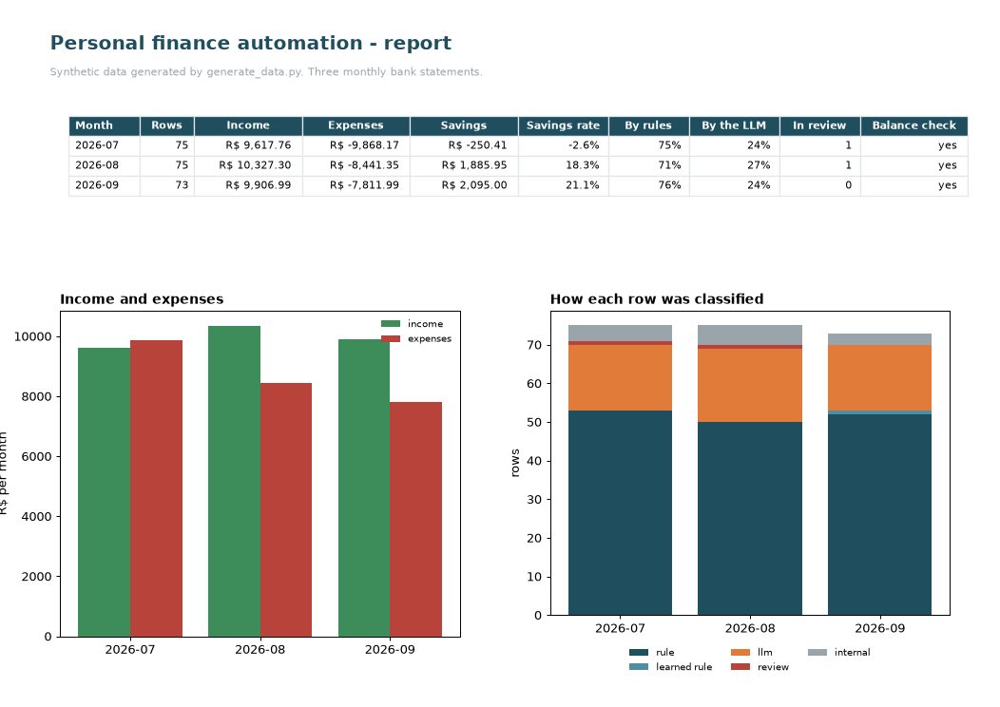

# personal-finance-automation

**[See it working](https://gcabralcavalcanti.github.io/personal-finance-automation/)** · [Final report, 2 pages (PDF)](final-report.pdf)

Public version, in Python, of the system I use for my own finances: it reads the monthly bank statement, puts every
transaction in a category and writes a monthly report. Fixed rules handle the usual shops; in this version Claude
handles the rest, and anything uncertain waits for me.




## What it shows

- Rules sort most of the statement; the AI only sees shops the rules do not know yet, and each confirmed answer
  becomes a new rule, so the AI is called less every month.
- Loading the same statement twice adds nothing, and every balance is checked line by line.
- The AI says how sure it is, and anything uncertain goes to a review list instead of the report
  ([`final-report.pdf`](final-report.pdf)).

## How I use it

My own system is an Excel workbook with a VBA engine and no AI; this public version in Python adds the AI step.
Details: [How I use it](docs/how-it-works.md#how-i-use-it).

## Run it

```
pip install -r requirements.txt
python demo.py
```

Runs without an API key, replaying recorded answers. Set `ANTHROPIC_API_KEY` to call Claude live.

## More

- [How it works](docs/how-it-works.md): the steps, the statement format, how to use another bank, privacy in detail.
- [Runbook](RUNBOOK.md): monthly use and what to do when something breaks.

## Privacy

Only the shop description goes to the API, never amounts, dates or account data, and names of people in transfers
are replaced by `<PERSON>` before sending (Brazil's data protection law, LGPD). Everything in this repository is
synthetic.

## Limits

- One statement layout out of the box (Brazilian CSV); other banks need a small change in one file.
- The AI's confidence is not a guarantee: its one wrong test answer came with high confidence.
- No credit-card bill import in this public version.

## How AI was used

I use Claude (Claude Code and the API) for coding, review and documentation. The questions, modelling choices,
validation and conclusions are mine.

MIT License.
