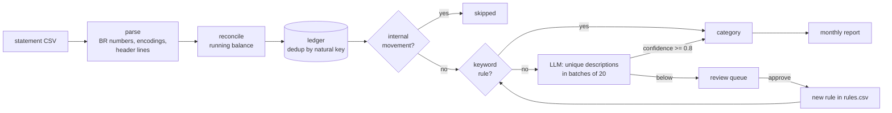

# personal-finance-automation

Turns a Brazilian bank-statement CSV into a categorized ledger and a monthly report. Each import is
checked against the statement's running balance and deduplicated, so importing the same file twice, or
two statements whose periods overlap, never creates a duplicate row. Keyword rules classify most rows.
Claude classifies the rest in batches, sending only unique descriptions and returning a confidence for
each one. Confident answers are applied, and the others wait for a person to review them. Every
approval becomes a new keyword rule, so the same merchant costs nothing next month.

All data is synthetic, generated by `generate_data.py`.

## Pipeline



## Quickstart

```
pip install -r requirements.txt
python -m finance_automation demo          # no API key needed: replays the recorded answers
python -m pytest -q                        # 46 tests, no network
```

`demo` runs these steps: generate the data, import three months, import month 1 again (0 new rows),
approve the review suggestions that have a concrete category (an "Other" guess waits for a person), write `reports/2026-07.md`, `2026-08.md` and `2026-09.md`, and run
the eval.

The same steps one at a time:

```
python generate_data.py
python -m finance_automation import data/statements/statement-2026-07.csv
python -m finance_automation review                                   # list the queue
python -m finance_automation review --approve <id> --category Income # or --approve-all-suggested
python -m finance_automation report --month 2026-07                   # reports/2026-07.md + .json
python -m finance_automation eval
```

To run live, put `ANTHROPIC_API_KEY` in the environment or in `.env` (see `.env.example`), then run
`python -m finance_automation demo --live`. The code checks the recorded answers first, so it only pays
for requests that have not been recorded yet. Add `--demo` to any command to block API calls entirely.

## How classification works

1. **Internal movements are skipped.** These are transfers to the holder's own accounts, investment
   applications and redemptions, credit-card bill payments and cash withdrawals. They are neither
   income nor expense.
2. **Keyword rules** (`data/rules.csv`). Each keyword is matched as a substring of the normalized
   description (uppercase, accents removed), and the longest keyword wins. For example,
   `RANGOJA*MERCADINHO` (Groceries) beats `RANGOJA` (Restaurants & Delivery). A rule can also have:
   - an **origin** filter: `in`, `out`, or a piece of the history text. The same keyword can then map to
     Shopping when money goes out and to Income when it comes in. If the origin does not fit, the next
     shorter keyword is tried.
   - a **value condition** that switches the row to `value_category`: `min`, `max` and/or
     `cents` = `round` / `non-round`. For example, `AUTO POSTO` is Transport (fuel is paid in round
     values), but a non-round amount there is a convenience-store snack (Groceries).
3. **LLM.** Only unique descriptions that no rule matches and that have no earlier label are sent,
   20 per call. The answer must follow a JSON Schema (structured output): for each item an index,
   a category from the fixed enum, a confidence from 0 to 1, a short reason, and a `suggested_keyword`
   (the merchant core). The answer is then checked locally: every index appears exactly once, the
   category is in the enum, and the keyword is a substring of the description. If a check fails, the
   request is retried once with the checker's complaints. Labels with confidence >= 0.8
   (`FINANCE_CONFIDENCE`) are applied with method `llm`. The rest go to the review queue.
4. **Review** (`review --approve ID [--category X]` or `--approve-all-suggested`). An approved item is
   appended to `rules.csv` as a new rule with `source=review`, after a check that the keyword is part
   of the description, has at least 3 characters and is not already a rule. The ledger is then
   reclassified.

This loop is why the API bill shrinks every month. Rules catch recurring merchants, the LLM only sees
descriptions it has never seen before, and each human approval turns an LLM answer into a free rule.
On the synthetic data, the seed rules catch 69.5% of rows. Month 1 sends 13 descriptions to the LLM,
and months 2 and 3 send only 9 each, because the other descriptions already have labels.

Every row in the report says how it was classified: seed rule, learned rule, LLM, human, waiting in
review, or internal.

## Idempotency

Each row's natural key is (date, history, description, amount, balance). The ledger (SQLite,
`data/ledger.sqlite`, not versioned) stores the key as a unique column and inserts with
`INSERT OR IGNORE`. Two equal purchases on the same day stay separate because their running balances
differ. In the demo, re-importing month 1 reports `75 rows, 0 new, 75 duplicates skipped`.

The statement check confirms that every row's balance equals the previous balance plus the row's
amount, in either table order, and that the header balance matches the closing balance. The result
appears in each report.

## Cost controls

| Control | Setting |
|---|---|
| Model | `claude-haiku-5-5` (USD 0.10 / 0.50 per million input / output tokens), thinking disabled, effort low |
| Output budget | 150 + 90 tokens per item (1,950 for a full batch of 20). A truncated answer is retried once with 1.5x the budget |
| Call cap | `FINANCE_MAX_CALLS`, default 10 per run. At the cap the run stops cleanly and leaves the rest unclassified |
| Batching | unique descriptions only, 20 per call. The system prompt is fixed, so it is stable for prompt caching (at its current size it is below the minimum cacheable length) |
| Response cache | every checked answer is saved in `recordings/<task>-<hash>.json` (versioned), so an identical request is never paid twice. Without a key, the recordings replay the run |
| Timeouts and retries | 45 s timeout, 2 SDK retries for network errors, 1 schema retry |
| Log | one JSON line per call in `logs/` (not versioned), with tokens and estimated cost. Each command prints a summary |

**Measured cost.** The recordings were created in two live runs: 9 API calls, 16,727 input tokens and
7,911 output tokens, about **USD 0.0056** in total. Four of those calls were truncated answers from a
first output budget that was too small. That budget was measured and fixed, so the 5 calls that were
kept cost USD 0.0029. A typical new month is one call of about 1.7k input and 0.6k output tokens,
roughly USD 0.0005.

## Eval

`python -m finance_automation eval` classifies the golden set (`golden/labels.csv`) and scores the
result. The golden set has the 31 unique descriptions in the synthetic statements that the seed rules
miss, each with its expected category. The eval replays recordings, so re-running it is free.
Full table: `reports/eval.md`.

| Metric | Result |
|---|---|
| Accuracy, all answers | 30 / 31 (96.8%) |
| Auto-applied (confidence >= 0.8) | 28, of which 27 correct (96.4%) |
| Sent to review | 3, all three person-name Pix transfers |
| Only error | `VIDEOAULAS PREMIUM MENSAL`: expected Education, predicted Subscriptions (0.90). This row is genuinely ambiguous |

The label of a person-name transfer can change between calls. During the import, `MARCOS A ROCHA`
(money received) came back as Other (0.40). In the eval batch it came back as Income (0.55). Both
answers fall below the threshold, which is the reason ambiguous rows go to a person. The bulk approval
(`--approve-all-suggested`, used by the demo) skips "Other" guesses, so they stay in the queue until a
person runs `review --approve <id> --category Income`.

## Origin

This is a public rewrite of a personal tool I use every month. The original also has an Excel/VBA front
end that is described here but not included. It has buttons to consolidate the month, category
dropdowns that override a row and write the choice back, undo, and a dashboard sheet. The rules
format (keyword, category, origin, min/max, value category, round/non-round cents) and the
deduplication key come from that tool. The code, the merchants and the data here are new.

## Layout

```
finance_automation/
  statement.py   CSV parsing and running-balance check
  ledger.py      SQLite ledger, dedup by natural key
  rules.py       rules.csv, longest-first matching, origin and value conditions, internal movements
  classifier.py  system prompt, JSON Schema, checks, batching, threshold
  llm.py         API wrapper: recordings, call cap, retries, logging
  review.py      review queue, approval -> new rule -> reclassify
  report.py      monthly report (markdown + json)
  evaluate.py    golden-set eval
  synthetic.py   synthetic statements, seed rules, golden labels
data/            statements and rules.csv (versioned); ledger.sqlite (not versioned)
golden/          labels.csv
recordings/      recorded LLM answers (versioned)
reports/         sample reports and eval.md (versioned)
tests/           pytest, no network
```

## Limitations

- Only bank statements in the CSV layout shown in `statement.py` are supported. The original tool
  also imports credit-card bills from PDF, which is not included here.
- Rules are substring matches. A short learned keyword such as a first name could catch unrelated
  rows, so review keeps the full merchant core and refuses keywords under 3 characters.
- A human decision that produced no rule (an invalid keyword) is stored per description. A later rule
  that matches the same description takes precedence over it.
- The synthetic data has one account holder and three months. Real statements have messier
  descriptions, such as reference numbers and truncated names, and a lower rule coverage at the start.
- The eval runs on 31 descriptions written for this repository, so 96.8% shows that the loop works. It
  is not a benchmark.
